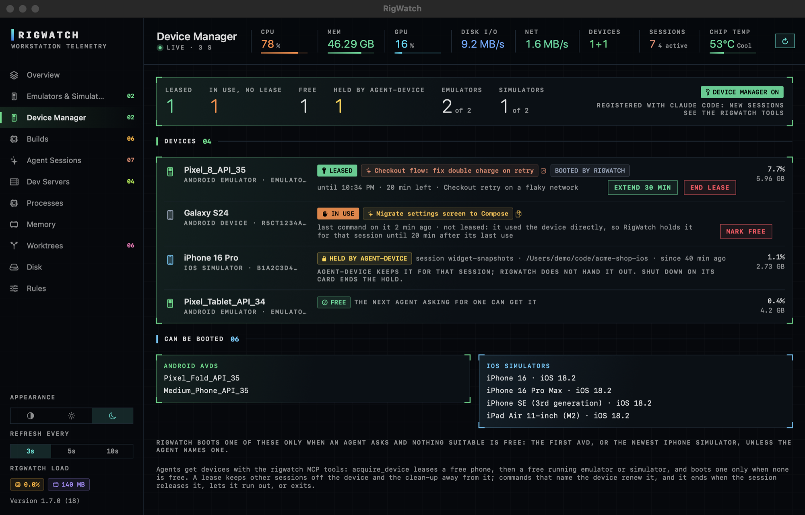
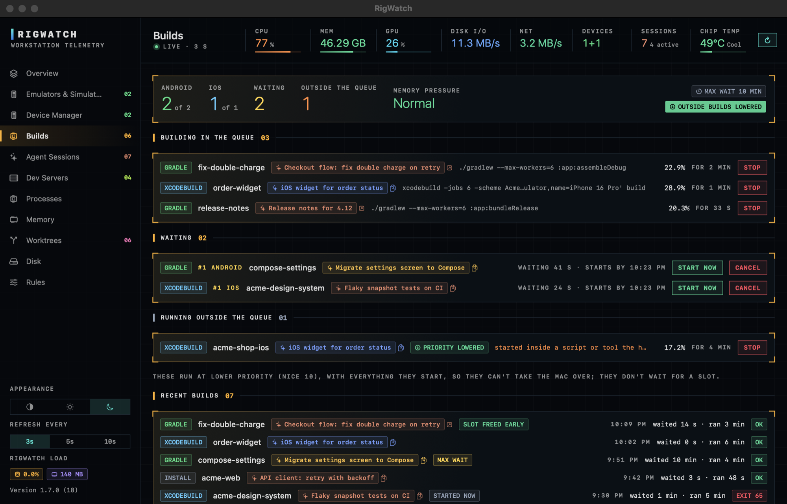
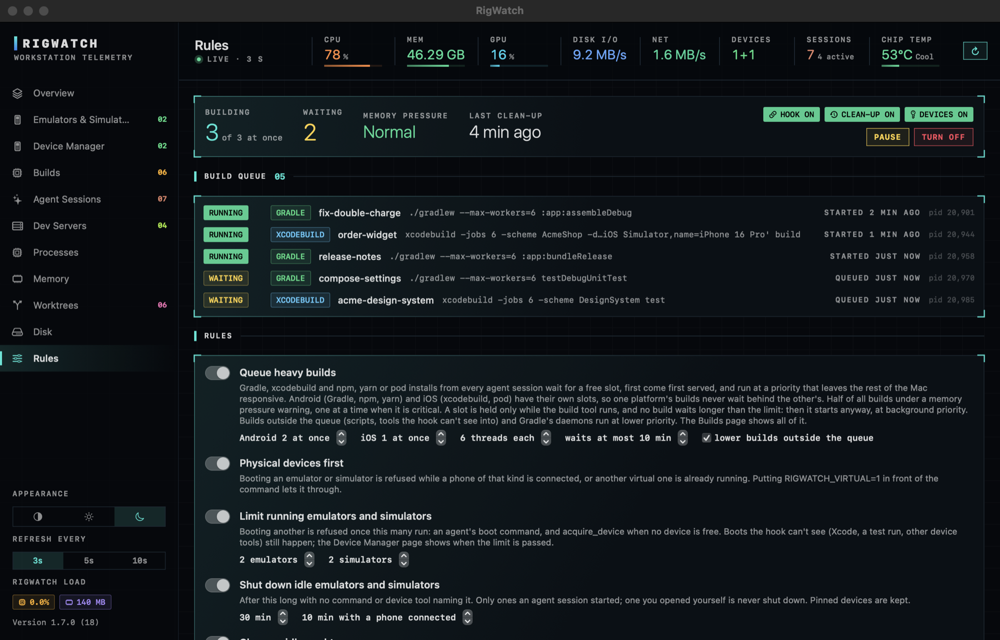
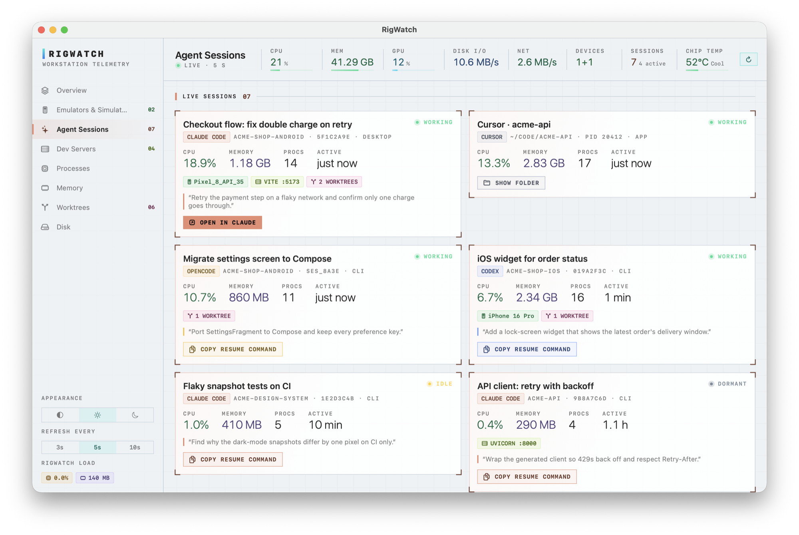
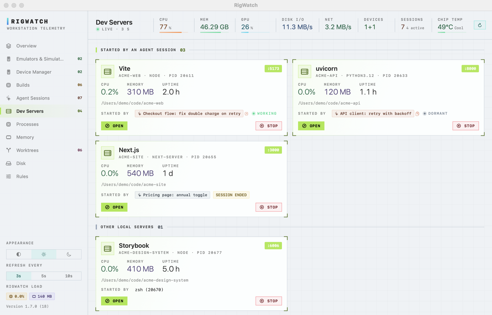

<p align="center">
  
</p>

<h1 align="center">RigWatch</h1>

<p align="center">
  <b>Your Mac is crawling. Activity Monitor won't tell you why. RigWatch will.</b><br>
  It groups every process by who started it: agent sessions, dev servers, emulators, builds.<br>
  Then it cleans up what you don't need, including the worktrees your agents left behind, without losing work.
</p>

<p align="center">
  <code>brew install bravoshubham/tap/rigwatch</code>
</p>

<p align="center">
  
</p>

## Why

Run a few coding agents on a Mac for a day and this is what you find:

- Three agent sessions, each with a tree of forty processes, and no way to tell which one is eating 12 GB.
- Dev servers, test watchers and MCP servers those agents started, still running long after you moved on.
- Thirty worktrees the agents created, each with its own `node_modules` or build folder, and no idea
  which ones are safe to delete.
- An emulator or simulator nobody has touched since Tuesday, still holding 6 GB.
- A local model in Ollama, LM Studio or llama.cpp holding 40 GB of memory and keeping the GPU busy
  while your build crawls.
- Docker, package caches, DerivedData and Gradle quietly taking 200 GB of disk.

Web, backend, mobile or local AI, it is the same story.

Activity Monitor shows all of it as 700 unrelated processes. RigWatch groups everything by
**who started it**, shows it as one picture, and closes what you don't need behind a confirmation.

## What it shows

| Page | What you get |
| --- | --- |
| **Overview** | A chip-die map of what is using the machine, sized by memory or CPU; what is still available is a thin bar under it. Click any block to see what's inside it, with the biggest processes listed and explained. Live CPU, memory, GPU load and GPU memory, disk, network and chip temperature, so a local model's load is visible next to everything else, and which processes are using the GPU (WindowServer, a browser, a local model), from the graphics driver's own per-process counters. |
| **Top CPU and memory** | Click the CPU or memory gauge (or the top bar) for what is using it right now: each group's biggest processes, who started them (agent session, dev server, emulator, app, macOS) and one action for each: Quit session, Stop, Shut down, Quit app or Quit. macOS's own processes get a plain-words note instead (kernel_task, WindowServer, Spotlight's mds_stores, photoanalysisd, iCloud's bird and 40 more): what it is, why it is busy, and what to do, often nothing. |
| **When CPU spikes** | CPU at 70% or more for two samples in a row puts a banner on Overview naming the top culprits, their share and who started them, e.g. `swift-frontend ×14 (started by <session>) 56%`. A timeline keeps the last 15 minutes in memory; click any bar to see what was on top at that moment, including spikes that happened while the window was closed. |
| **Agent Sessions** | Every coding agent running, with its CPU, memory, devices, worktrees and every process it started: dev servers, test runners, MCP servers, builds. Claude Code, OpenCode and Codex also show the session title and last prompt, and can be resumed. Cursor, Windsurf, T3 Code, Gemini CLI, Aider, Goose and Amp are recognised from their processes. |
| **Dev Servers** | Every local server you started, by the port it listens on: a framework guess (Vite, Next.js, Storybook, Rails, Django, uvicorn and more), project folder, uptime, CPU and memory, and which agent session started it. That link is remembered, so a server left running after its session ended still says who started it. Open it in the browser, or stop it behind a confirmation. |
| **Emulators & Simulators** | Each Android emulator and iOS simulator: what it's showing, which session launched it, the last command a session ran on it, whether it is leased, in use or held by agent-device, a live screen that opens at once, **Ask session** (is it safe to shut down?), and a graceful shut-down that also ends an agent-device hold, so it stays off. |
| **Device Manager** | Every phone, emulator and simulator agents can be given, and who holds it: free, leased to a session (purpose, until when, booted by RigWatch), in use by a session that drives it directly, or held by agent-device. Extend a lease, end it, or mark a device free; running counts against the limits, and the AVDs and simulators RigWatch could boot. See [Hand out devices](#rules-one-mac-many-agents). |
| **Builds** | Every Gradle, `xcodebuild` and install build: what holds an Android or iOS slot, what waits (its place, how long, and when it starts at the latest), what runs outside the queue and whether its priority is lowered, and recent builds with time waited and run. Start a waiting build now, cancel it, or stop a running one. |
| **Processes** | Grouped by app or tool, with CPU on one scale (100% = the whole machine), each process's share of GPU time, and quit or force-quit behind a confirmation. |
| **Memory** | Where the RAM went: apps, wired, compressed, file cache, swap and pressure, and **what you can free**: idle emulators and simulators, dormant agent sessions, abandoned dev servers, a loaded local model and big apps, each with its size and one button, adding up to "you could free ~X GB". GPU memory (a local model's weights) is counted once, in the process that holds it, not again as Kernel & drivers. |
| **Worktrees** | Every `git worktree` under your home folders, which session made it, how much disk it takes, whether anything is using it, and a remove that refuses to lose uncommitted or unpushed work. |
| **Disk** | The whole drive as a chip-die map of folders. Click into any folder; right-click to show it in Finder. |
| **Rules** | Keeps the Mac usable while many agent sessions build at once: an Android and an iOS build queue, a device manager agents get devices from, physical devices before emulators, a limit on running emulators and simulators, and a clean-up of idle emulators, simulators, worktrees and DerivedData. Off until you turn it on. See [Rules](#rules-one-mac-many-agents). |

<p align="center">
  
  
</p>
<p align="center">
  
  
</p>
<p align="center">
  
  
</p>
<p align="center">
  
  
</p>
<p align="center">
  
  
</p>
<p align="center">
  
  
</p>
<p align="center">
  
  
</p>

## Rules: one Mac, many agents

Agent sessions don't know about each other. Five of them each start a Gradle build, boot an emulator
"to test" with a phone already plugged in, and create a worktree with its own 12 GB `node_modules`,
and the Mac is at load 300 with swap full. The Rules page fixes that, for every Claude Code session
at once, desktop app and terminal alike:

- **Queue heavy builds.** Gradle, `xcodebuild` and npm, yarn or pod installs wait for a free slot
  (Android and iOS have their own: 2 and 1 at once by default, fewer under memory pressure), first
  come first served within each, at a priority that keeps the rest of the Mac responsive, with a
  thread cap each. A slot is held only while the build tool itself runs, not while the rest of the
  command (installs, logcat, waits) does, and no build waits longer than 10 minutes: then it starts
  anyway, at background priority. A session whose build has to wait gets it moved to the background
  and keeps working. Builds the hook can't see (inside scripts and other tools) and Gradle's daemons
  run at lower priority instead. The **Builds** page shows what holds a slot, what waits and until
  when, what runs outside the queue, and recent builds, with Start now, Cancel and Stop.
- **Share dependencies between worktrees.** A new worktree gets `node_modules`, CocoaPods' `Pods` and
  Xcode's resolved packages, module cache and compilation cache (with `-derivedDataPath`) as APFS
  clones, from another worktree of the repository or RigWatch's store, whenever they match its
  lockfile (`package-lock.json`, `yarn.lock`, `pnpm-lock.yaml`, `Podfile.lock`). It happens before
  any install or build that goes through RigWatch, and on request with the MCP tool
  `prepare_worktree`; the install then only checks, instead of downloading gigabytes again. Each
  successful install refills the store. Only into folders git ignores. A build alone on the Mac gets
  more threads than the minimum set on the Rules page, up to all cores but two.
- **Physical devices first.** Booting an emulator or simulator is refused while a phone of that kind
  is connected or another virtual one is already running. `RIGWATCH_VIRTUAL=1` in front of the command
  lets it through.
- **Limit running emulators and simulators** (2 of each by default). Past the limit an agent's boot
  command is refused, with no override, and `acquire_device` boots nothing. Boots RigWatch can't see
  (Xcode, a test run, other device tools) still happen; the Device Manager page shows when the limit
  is passed.
- **Shut down idle emulators and simulators** after 30 minutes with no command or device tool naming
  them (10 with a phone connected). Only ones an agent session started; one you opened yourself is
  never shut down. Pin one to keep it.
- **Clean up idle worktrees** untouched for a day: a clean one is removed (its branch and commits
  stay); one with uncommitted work, commits on no remote or untracked files keeps its source and loses
  only build folders git ignores. `node_modules` is kept aside first and cloned back (APFS, seconds,
  no extra disk) into the next worktree with the same lockfile. Worktrees Claude Code manages itself
  are left alone.
- **Delete orphaned DerivedData** whose project is provably gone: its folder can be read and no longer
  holds it. Projects on external drives or in folders macOS guards are left alone.
- **Ask the session before shutting a device down.** On an emulator or simulator card linked to a live
  Claude Code session, **Ask session** leaves the question for that session; the hook hands it over
  with the session's next Bash or MCP tool call, and the agent answers with `RigWatch answer`. The card
  then shows "safe to close" or "keep" with its reason. Nothing is shut down for you. An idle session
  makes no tool calls, so it cannot answer until it does something; the card says so. Questions lapse
  after 30 minutes.
- **Never clean up** lists folders the clean-up leaves alone completely (e.g. `~/work, ~/clients`).
- **Hand out devices.** RigWatch is also an MCP server (`RigWatch mcp`) that agents ask for a device:
  `acquire_device` gives a session a free connected phone or a free running emulator or simulator, and
  boots one only when none is free. The device is leased to that session: no other session is given
  it, the hook warns a session that names a device leased to another, and the clean-up leaves it
  alone. Commands naming the device keep the lease going; it ends when the session releases it
  (`release_device` shuts down what RigWatch booted), when it runs out (30 minutes by default), or as
  soon as the session's Claude Code process exits. `list_devices`, `renew_device`, `prepare_worktree` and
  `build_queue` round it off. Using a device directly counts too: when a session's command names a device (`adb -s`,
  `ANDROID_SERIAL`, a simulator UDID, a device tool's serial, or plain `adb` or a Gradle install with
  one device connected), that session holds it, as **In use**, until 20 minutes after its last use,
  so the device manager won't hand it to another session. Devices held by
  [agent-device](https://github.com/callstack/agent-device) are respected as well: RigWatch
  never hands them out, the clean-up keeps them, and Shut Down ends the hold so they stay off.

**Turn on** adds a `PreToolUse` hook to `~/.claude/settings.json` (the old file is kept as
`settings.json.rigwatch-backup`), registers the MCP server for every Claude Code session
(`claude mcp add --scope user rigwatch`), and adds a LaunchAgent that runs the clean-up every 10 minutes; for its
first hour the clean-up only reports. **Preview** shows what it would do, **Pause** stops everything.
The same commands work from a terminal:

```text
RigWatch run [--kind K] -- CMD...   run CMD once a build slot is free
RigWatch reap [--apply]             the clean-up (reports only without --apply)
RigWatch wt REPO BRANCH [BASE]      new worktree beside the repo, in .wt/, with node_modules cloned in
RigWatch pin|unpin ID               keep an emulator or simulator from the clean-up
RigWatch answer ID yes|no [REASON]  answer RigWatch's question whether a device can be shut down
RigWatch status                     what is running, queued, booted and leased
RigWatch mcp                        the MCP server agents get devices from (Claude Code starts it)
RigWatch install|uninstall          turn the rules on or off
```

(`RigWatch` is `~/Applications/RigWatch.app/Contents/MacOS/RigWatch`, or `rigwatch` with Homebrew.)
The hook adds about 30 ms to a tool call. Sessions of other agents are not routed through it yet,
and a Claude Code session started before the rules were turned on keeps running without them until it
is restarted (the Builds page says which builds that leaves outside the queue).

## Install

Requires **macOS 14 (Sonoma) or later** on Apple silicon (Intel is untested).

### With Homebrew

```bash
brew install bravoshubham/tap/rigwatch
rigwatch
```

Homebrew builds RigWatch on your Mac from source (about 20 seconds), so macOS opens it without a
Gatekeeper warning. The first time you run `rigwatch`, it puts a copy of itself in
`~/Applications`, so Spotlight, Launchpad and Finder find it from then on.

To update:

```bash
brew update && brew upgrade rigwatch
```

`brew update` makes Homebrew check for a new RigWatch right away; on its own, `brew upgrade` may skip
the check if Homebrew looked recently. Nothing else to do: within a minute a running RigWatch
notices the new build, updates the copy in `~/Applications` and restarts on it. If its window is
open, it asks first with a Restart button (also in the menu bar menu), so nothing is cut short.

### From source

Needs the Xcode Command Line Tools (`xcode-select --install`).

```bash
git clone https://github.com/bravoshubham/rigwatch.git
cd rigwatch
./bundle.sh
open ~/Applications/RigWatch.app
```

`bundle.sh` builds a release binary, wraps it in `~/Applications/RigWatch.app` with its icon, and
signs it for this Mac. Run it again to update.

### From a release download

Release builds are not notarized by Apple, so macOS blocks the first launch. Either:

- open **System Settings → Privacy & Security**, scroll to the RigWatch message and click **Open Anyway**, or
- run `xattr -dr com.apple.quarantine /Applications/RigWatch.app` once.

### Try it without your own data

```bash
rigwatch -demo                                               # Homebrew install
~/Applications/RigWatch.app/Contents/MacOS/RigWatch -demo    # built from source
```

Demo mode fills every page with made-up sessions, devices and folders. Nothing is sampled, scanned
or closed while it is on. Every screenshot above was taken in it.

### Uninstall

If you turned the rules on, turn them off first (Rules page → Turn off, or `RigWatch uninstall`).
Then quit RigWatch and remove the app:

```bash
brew uninstall rigwatch
```

Remove the copy it keeps in your Applications folder:

```bash
rm -rf ~/Applications/RigWatch.app
```

Remove its settings (window position, saved folder sizes, which session started each dev server):

```bash
defaults delete dev.rigwatch.RigWatch
```

Remove the Rules state (settings, build queue, clean-up log and the `node_modules` cache):

```bash
rm -rf ~/Library/Application\ Support/RigWatch
```

Built from source instead? Skip `brew uninstall`; the other steps are the same. RigWatch keeps
nothing else on your Mac.

## Light on the machine it watches

- Samples every 5 seconds while the window is open (3, 5 or 10 s in the sidebar). While it is hidden,
  a CPU and memory check every 5 seconds (Mach calls only) keeps the spike history going; processes
  are listed only while CPU is at 70% or more or memory pressure is up, at most every 10 seconds, and
  everything else is sampled once a minute. Measured on an M5 Max: about 2.4% of one core with
  Overview open at 3 s, 0.25% hidden, 120–220 MB.
- Machine-wide numbers come from Mach, sysctl and IOKit directly, with no helper processes.
- Listening ports come from libproc, not `lsof`, at most every 3 seconds and only for processes
  that are new or already listening (plus a sweep every 30 seconds).
- Disk sizes use `du` at macOS background priority, at most three at a time. The automatic rescan
  runs at most every six hours; **Rescan** runs one now.
- The menu bar shows CPU, GPU and memory at a glance.

## Safety and privacy

- **Nothing is closed without asking.** Every quit, shut-down and removal shows what will happen
  and who is using it first. macOS's own processes and other users' processes are never offered.
  Quit app asks the app to quit the way ⌘Q does, so it can ask to save first.
- **Quit session ends a session's own agent process**: on a live session card it sends SIGTERM to
  that session's terminal `claude` (or other agent) process after saying which pid it is and the
  command that resumes it. Sessions in the Claude desktop app are left to the app (archive them there).
  RigWatch does not stop the processes the session started: its MCP servers normally exit with it,
  and dev servers it left running stay on Dev Servers.
- **Worktree removal is checked first**: anything with uncommitted changes, untracked files (other
  than build output), unpushed commits or a process inside it is kept.
- **Process environments are never stored.** RigWatch reads exactly two variables from its own
  processes, `CLAUDE_CODE_SESSION_ID` and `CLAUDE_CODE_HOST_SESSION_ID`, to link processes to a
  session. Tokens and everything else in the environment are skipped.
- **Dev server owners are kept only while the server runs**: RigWatch's preferences hold the
  process id, session id and session title for each running server, and drop them when it exits.
- **Agent session files are read, never written**: Claude Code transcripts in `~/.claude/projects`,
  OpenCode's database (opened read-only), Codex's rollouts in `~/.codex/sessions`.
- **The Rules clean-up never removes work.** A worktree is removed only when it is clean, has no
  commit missing from every remote, no process inside and no untracked file git does not ignore; it
  is checked again right before removal. Only build folders git ignores are ever deleted. Main
  checkouts, locked worktrees, Claude Code's own worktrees and never-clean folders are never touched.
- **Nothing leaves the Mac.** No network calls, no analytics, no accounts.

## Why it isn't on the Mac App Store

App Store apps must run in Apple's sandbox, which forbids reading other processes, running `ps`,
`du`, `git`, `adb` or `simctl`, and closing other apps: everything RigWatch is for. The chip
temperature also comes from a private Apple interface, which App Review does not allow.

## Permissions

None are required, and RigWatch never triggers a macOS privacy prompt. The Disk map does not open
folders macOS guards: Desktop, Documents, Downloads, Music, Movies, Pictures, the Photos library,
iCloud Drive and other cloud drives, and Apple's own app data. Those, plus anything else macOS
won't let it read (Mail, Safari, other users'), are counted in the "System & protected" block.

## Building and hacking

```text
Sources/RigWatch/
  App.swift          app, window and menu bar
  Monitor.swift      the sampler loop, actions, disk scans
  SystemStats.swift  CPU, memory, GPU, disk, network, temperature
  Procs.swift        processes and grouping
  Agents.swift       agent detection; OpenCode and Codex session stores
  Sessions.swift     Claude Code transcripts
  Devices.swift      Android emulators (adb) and iOS simulators (simctl)
  DevServers.swift   listening ports (libproc), framework guess, who started each server
  Worktrees.swift    git worktrees and the safe-removal check
  Demo.swift         the -demo data set
  Theme.swift        colours, panels, gauges
  Views.swift        every page, and the chip-die treemap
  Insight.swift      Top CPU/memory, who started what, the spike banner and timeline, what you can free
  Explain.swift      plain-words notes for common macOS processes
  Rules.swift        the hook, the build queue, the clean-up and the command line
  RulesView.swift    the Rules page
  main.swift         runs a command-line command, or opens the app
Assets/make-icon.swift   draws Assets/AppIcon.png
```

`swift build` for a debug build, `./bundle.sh` for the app. To redraw the icon:
`swift Assets/make-icon.swift Assets/AppIcon.png`.

Adding an agent: give it a case in `Agent` (`Agents.swift`) and a line in `Agent.of` that recognises
its process. If it keeps session files, add a store like `OpenCodeStore` and match it to the live
process by working folder.

## Not affiliated

RigWatch is an independent project. It is not affiliated with, endorsed by or sponsored by Anthropic,
OpenAI, Cursor, Codeium, T3 or any other tool it detects. Product names are trademarks of their owners
and are used only to say what RigWatch recognises.

## License

[MIT](LICENSE)
