<p align="center">
  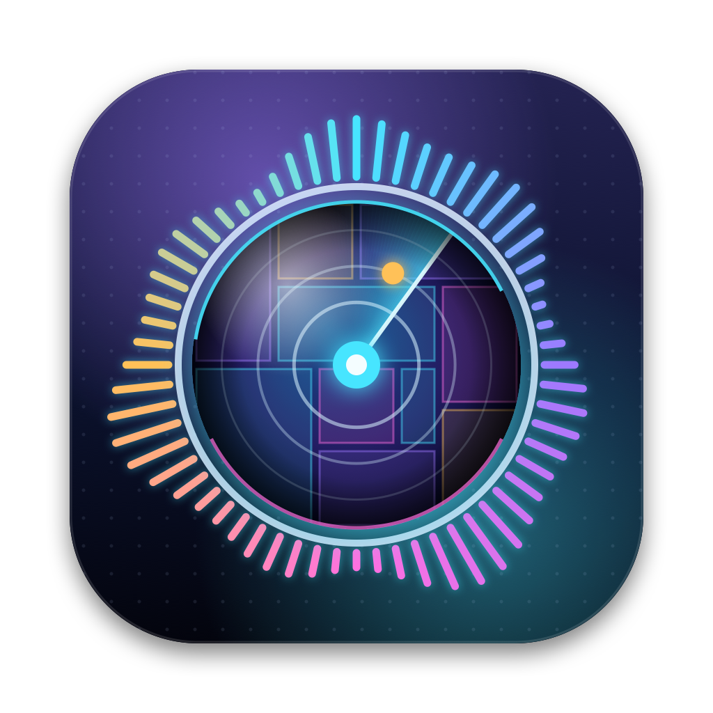
</p>

<h1 align="center">RigWatch</h1>

<p align="center">
  <b>Your Mac is crawling. Activity Monitor won't tell you why. RigWatch will.</b><br>
  It groups every process by who started it: agent sessions, dev servers, emulators, builds.<br>
  Then it cleans up what you don't need, including the worktrees your agents left behind, without losing work.
</p>

<p align="center">
  <code>brew install bravoshubham/tap/rigwatch</code>
</p>

<p align="center">
  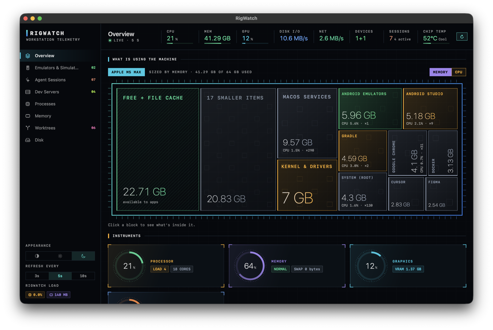
</p>

## Why

Run a few coding agents on a Mac for a day and this is what you find:

- Three agent sessions, each with a tree of forty processes, and no way to tell which one is eating 12 GB.
- Dev servers, test watchers and MCP servers those agents started, still running long after you moved on.
- Thirty worktrees the agents created, each with its own `node_modules` or build folder, and no idea
  which ones are safe to delete.
- An emulator or simulator nobody has touched since Tuesday, still holding 6 GB.
- Docker, package caches, DerivedData and Gradle quietly taking 200 GB of disk.

Web, backend or mobile, it is the same story.

Activity Monitor shows all of it as 700 unrelated processes. RigWatch groups everything by
**who started it**, shows it as one picture, and closes what you don't need behind a confirmation.

## What it shows

| Page | What you get |
| --- | --- |
| **Overview** | A chip-die map of the machine, sized by memory or CPU. Click any block to see what's inside it. Live CPU, memory, GPU, disk, network and chip temperature. |
| **Agent Sessions** | Every coding agent running, with its CPU, memory, devices, worktrees and every process it started: dev servers, test runners, MCP servers, builds. Claude Code, OpenCode and Codex also show the session title and last prompt, and can be resumed. Cursor, Windsurf, T3 Code, Gemini CLI, Aider, Goose and Amp are recognised from their processes. |
| **Dev Servers** | Every local server you started, by the port it listens on: a framework guess (Vite, Next.js, Storybook, Rails, Django, uvicorn and more), project folder, uptime, CPU and memory, and which agent session started it. That link is remembered, so a server left running after its session ended still says who started it. Open it in the browser, or stop it behind a confirmation. |
| **Emulators & Simulators** | Each Android emulator and iOS simulator: what it's showing, which session launched it, the last command a session ran on it, a live screen, and a graceful shut-down. |
| **Processes** | Grouped by app or tool, with CPU on one scale (100% = the whole machine) and quit or force-quit behind a confirmation. |
| **Memory** | Where the RAM went: apps, wired, compressed, file cache, swap and pressure. |
| **Worktrees** | Every `git worktree` under your home folders, which session made it, how much disk it takes, whether anything is using it, and a remove that refuses to lose uncommitted or unpushed work. |
| **Disk** | The whole drive as a chip-die map of folders. Click into any folder; right-click to show it in Finder. |

<p align="center">
  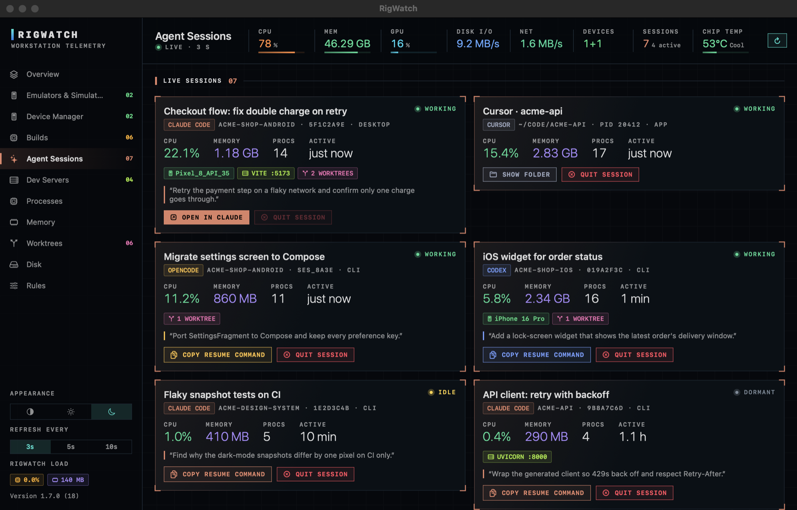
  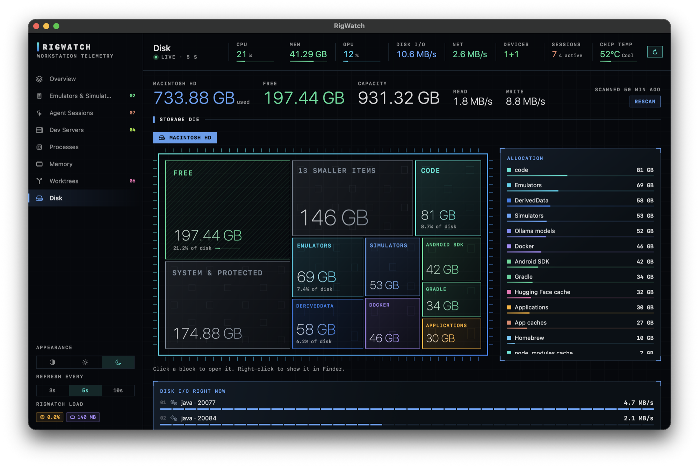
</p>
<p align="center">
  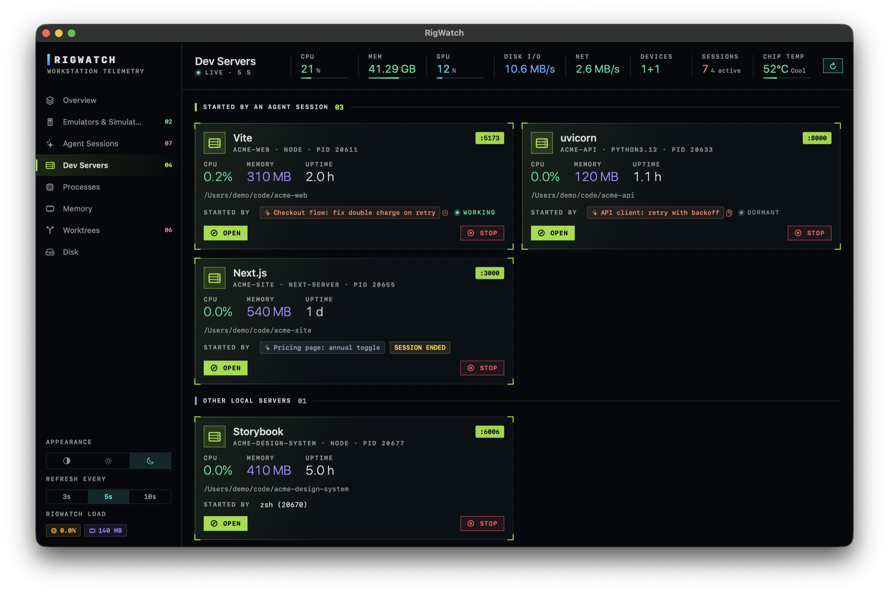
</p>
<p align="center">
  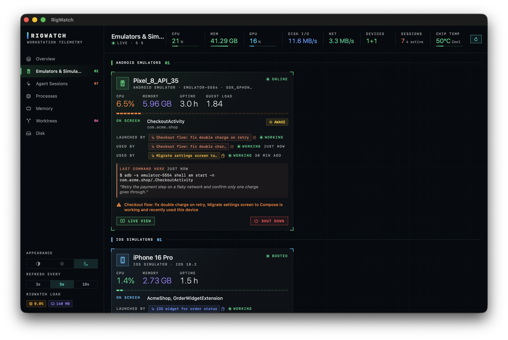
  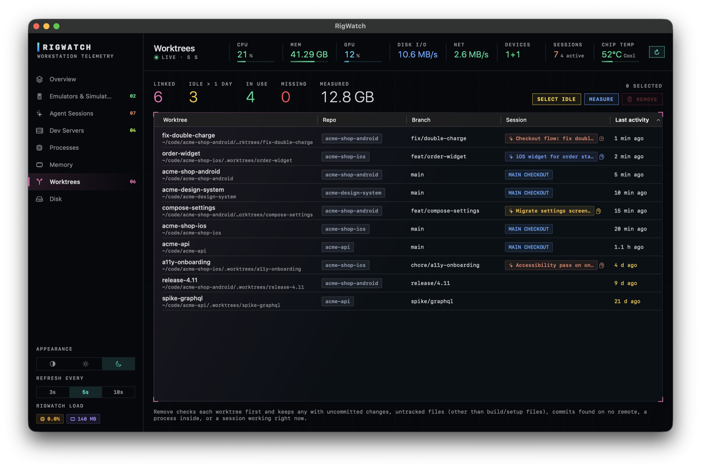
</p>
<p align="center">
  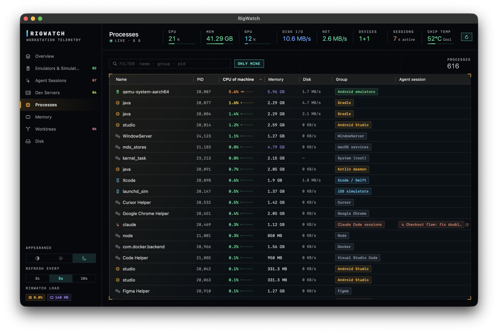
  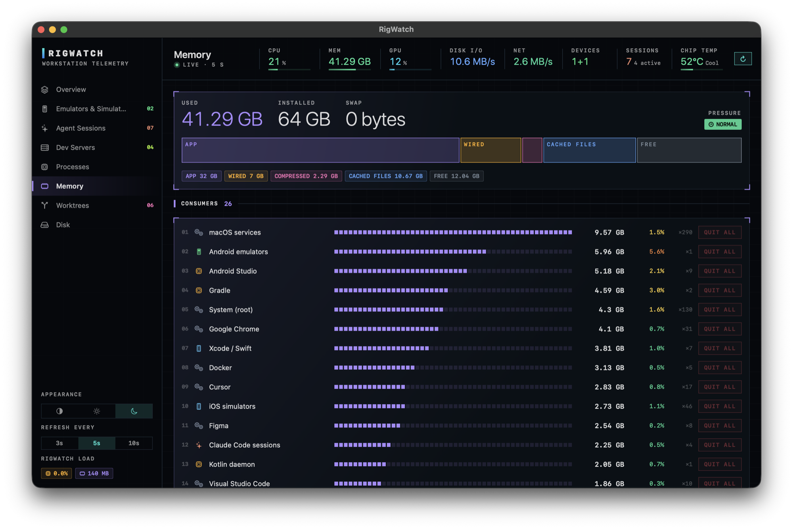
</p>
<p align="center">
  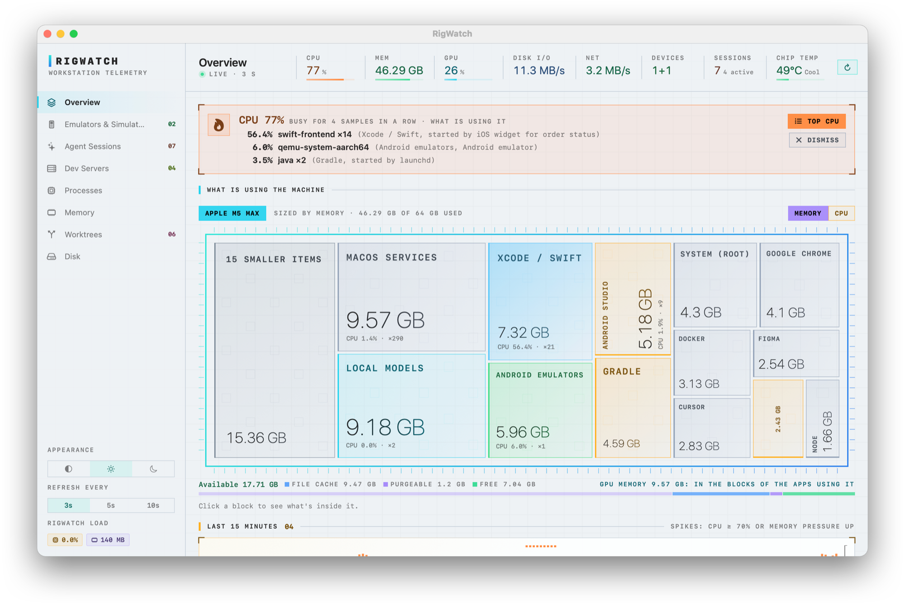
  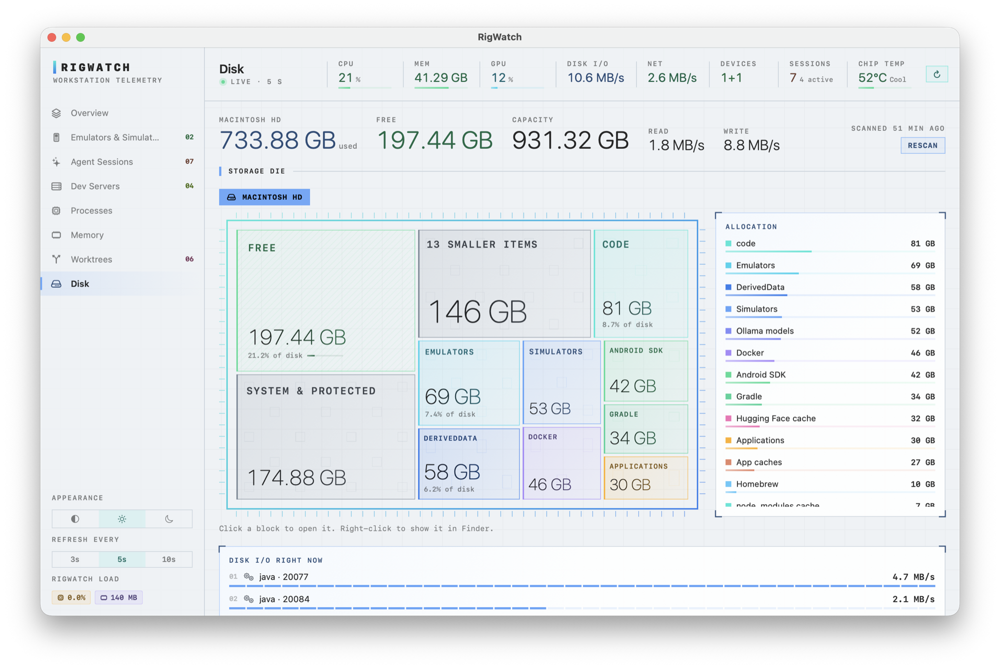
</p>

## Install

Requires **macOS 14 (Sonoma) or later** on Apple silicon (Intel is untested).

### With Homebrew

```bash
brew install bravoshubham/tap/rigwatch
rigwatch
```

Homebrew builds RigWatch on your Mac from source (about 20 seconds), so macOS opens it without a
Gatekeeper warning. Update with `brew upgrade`. To see it in your Applications folder too, run the
`ln -sfn …` line Homebrew prints after installing.

### From source

Needs the Xcode Command Line Tools (`xcode-select --install`).

```bash
git clone https://github.com/bravoshubham/rigwatch.git
cd rigwatch
./bundle.sh
open ~/Applications/RigWatch.app
```

`bundle.sh` builds a release binary, wraps it in `~/Applications/RigWatch.app` with its icon, and
signs it for this Mac. Run it again to update.

### From a release download

Release builds are not notarized by Apple, so macOS blocks the first launch. Either:

- open **System Settings → Privacy & Security**, scroll to the RigWatch message and click **Open Anyway**, or
- run `xattr -dr com.apple.quarantine /Applications/RigWatch.app` once.

### Try it without your own data

```bash
rigwatch -demo                                               # Homebrew install
~/Applications/RigWatch.app/Contents/MacOS/RigWatch -demo    # built from source
```

Demo mode fills every page with made-up sessions, devices and folders. Nothing is sampled, scanned
or closed while it is on. Every screenshot above was taken in it.

## Light on the machine it watches

- Samples every 5 seconds while the window is open (3, 5 or 10 s in the sidebar) and once a minute
  when it is hidden. Typically 0.1–2% of one core and 150–250 MB.
- Machine-wide numbers come from Mach, sysctl and IOKit directly, with no helper processes.
- Listening ports come from libproc, not `lsof`, at most every 3 seconds and only for processes
  that are new or already listening (plus a sweep every 30 seconds).
- Disk sizes use `du` at macOS background priority, at most three at a time. The automatic rescan
  runs at most every six hours; **Rescan** runs one now.
- The menu bar shows CPU and memory at a glance.

## Safety and privacy

- **Nothing is closed without asking.** Every quit, shut-down and removal shows what will happen
  and who is using it first. macOS's own processes and other users' processes are never offered.
- **Worktree removal is checked first**: anything with uncommitted changes, untracked files (other
  than build output), unpushed commits or a process inside it is kept.
- **Process environments are never stored.** RigWatch reads exactly two variables from its own
  processes, `CLAUDE_CODE_SESSION_ID` and `CLAUDE_CODE_HOST_SESSION_ID`, to link processes to a
  session. Tokens and everything else in the environment are skipped.
- **Dev server owners are kept only while the server runs**: RigWatch's preferences hold the
  process id, session id and session title for each running server, and drop them when it exits.
- **Agent session files are read, never written**: Claude Code transcripts in `~/.claude/projects`,
  OpenCode's database (opened read-only), Codex's rollouts in `~/.codex/sessions`.
- **Nothing leaves the Mac.** No network calls, no analytics, no accounts.

## Why it isn't on the Mac App Store

App Store apps must run in Apple's sandbox, which forbids reading other processes, running `ps`,
`du`, `git`, `adb` or `simctl`, and closing other apps: everything RigWatch is for. The chip
temperature also comes from a private Apple interface, which App Review does not allow.

## Permissions

None are required, and RigWatch never triggers a macOS privacy prompt. The Disk map does not open
folders macOS guards: Desktop, Documents, Downloads, Music, Movies, Pictures, the Photos library,
iCloud Drive and other cloud drives, and Apple's own app data. Those, plus anything else macOS
won't let it read (Mail, Safari, other users'), are counted in the "System & protected" block.

## Building and hacking

```text
Sources/RigWatch/
  App.swift          app, window and menu bar
  Monitor.swift      the sampler loop, actions, disk scans
  SystemStats.swift  CPU, memory, GPU, disk, network, temperature
  Procs.swift        processes and grouping
  Agents.swift       agent detection; OpenCode and Codex session stores
  Sessions.swift     Claude Code transcripts
  Devices.swift      Android emulators (adb) and iOS simulators (simctl)
  DevServers.swift   listening ports (libproc), framework guess, who started each server
  Worktrees.swift    git worktrees and the safe-removal check
  Demo.swift         the -demo data set
  Theme.swift        colours, panels, gauges
  Views.swift        every page, and the chip-die treemap
Assets/make-icon.swift   draws Assets/AppIcon.png
```

`swift build` for a debug build, `./bundle.sh` for the app. To redraw the icon:
`swift Assets/make-icon.swift Assets/AppIcon.png`.

Adding an agent: give it a case in `Agent` (`Agents.swift`) and a line in `Agent.of` that recognises
its process. If it keeps session files, add a store like `OpenCodeStore` and match it to the live
process by working folder.

## Not affiliated

RigWatch is an independent project. It is not affiliated with, endorsed by or sponsored by Anthropic,
OpenAI, Cursor, Codeium, T3 or any other tool it detects. Product names are trademarks of their owners
and are used only to say what RigWatch recognises.

## License

[MIT](LICENSE)
